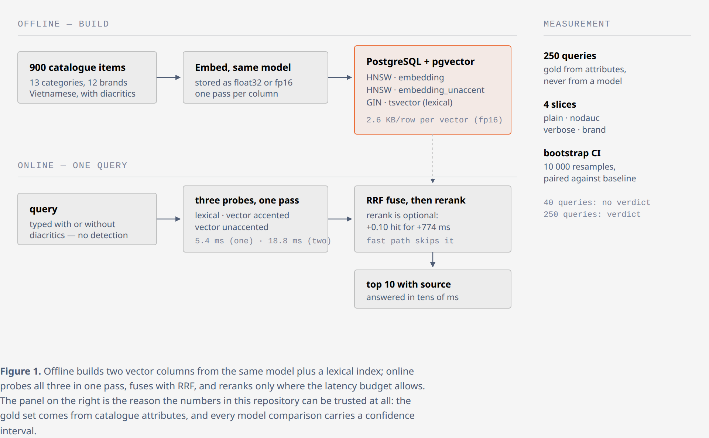
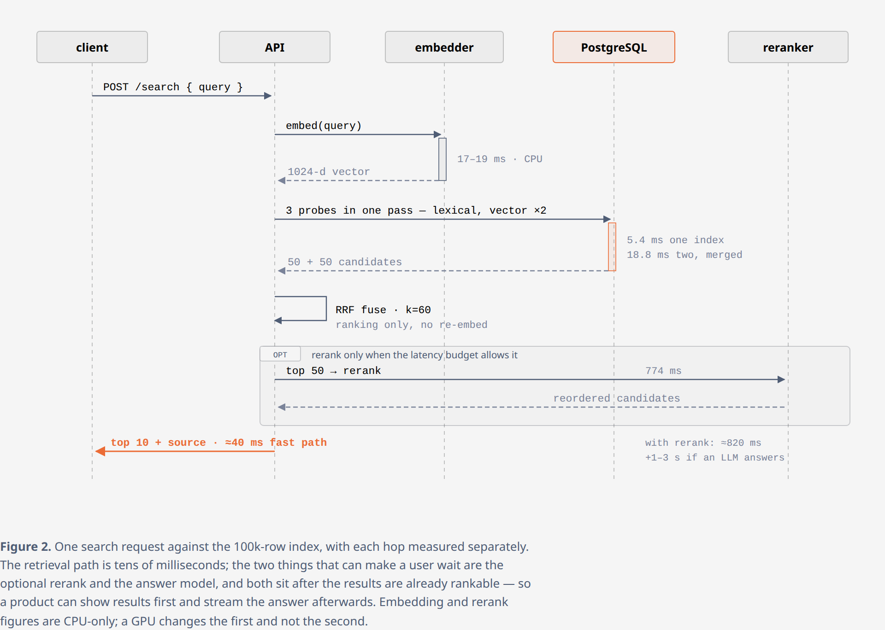

# pgvector-recall-lab

Does hybrid retrieval actually beat lexical search on a Vietnamese product catalogue — and by how much?

A JD for an "AI Application / Backend Engineer" in Hanoi asks for PostgreSQL, Vector Search,
Search, Ranking and Recommendation in the same sentence. That implies `pgvector`, not
Elasticsearch. This lab measures whether that choice holds up, on data shaped like the
catalogue such a product would index: building materials, lighting, sanitary ware.


## Results shipped with the repository

`results/` holds the raw JSON of every run cited in this README, so the numbers can be checked
without re-running anything:

| file | contents |
|---|---|
| `results/model_zoo.json` | five-model shootout, per query set, index size, encode throughput |
| `results/power_results.json` | per-query outcomes for the 250-query benchmark (bootstrap input) |
| `results/queries_power.json` | the 250 queries with their attribute-derived gold sets |
| `results/halfvec_results.json` | float32 vs fp16, per query |
| `results/diacritics_results.json` | accented / unaccented / best-of-both on unaccented queries |
| `results/scale_100000.json` | 2 x 100k-row index build times, sizes, latency |
| `results/rerank_jev.json` | second-stage rerank: quality, latency, token cost |

Reproduce from scratch (Postgres 16 + pgvector, Python 3.12):

```bash
docker compose up -d          # pgvector 0.8.7 on :55432
pip install --target /tmp/emblibs fastembed psycopg2-binary
PYTHONPATH=/tmp/emblibs make data index        # catalogue + baseline indexes
PYTHONPATH=/tmp/emblibs make power bootstrap   # 250 queries, per-model, with CIs
```

The heavier targets (`zoo`, `halfvec`, `diacritics`, `scale`) need
`pip install sentence-transformers` and, for `scale`, ~2 GB of RAM per 100k rows.

**Read this first:** [`docs/SEARCH-DECISIONS.md`](docs/SEARCH-DECISIONS.md) — the nine decisions this
lab ended up making, each with its number, its confidence interval and what the measurement does not
cover.

## What is measured

| Component | Choice |
|---|---|
| Catalogue | 900 synthetic items, 13 categories, 12 brands, Vietnamese names with diacritics |
| Embeddings | `paraphrase-multilingual-MiniLM-L12-v2`, 384 dims, ONNX via `fastembed` (CPU only) |
| Lexical index | `tsvector('simple')` over unaccented text + GIN |
| Vector index | `pgvector` 0.8.7, HNSW (m=16, ef_construction=64), cosine |
| Fusion | Reciprocal Rank Fusion, k=60, depth 50 per retriever |
| Query set A | 60 queries built from item attributes; half typed **without diacritics**; gold = same category + brand + variant |
| Query set B | 40 **paraphrase** queries where no query word appears in the product name |

## Results — query set A (exact-ish, how a spec search looks)

| strategy | recall@10 | hit@10 | MRR@10 | p50 ms | empty queries |
|---|---|---|---|---|---|
| lexical | 1.000 | 1.000 | 1.000 | 0.30 | 0 |
| vector | 0.768 | 0.867 | 0.601 | 0.99 | 0 |
| hybrid (RRF) | 1.000 | 1.000 | 0.992 | 0.02 | 0 |

## Results — query set B (paraphrase, how a customer actually types)

| strategy | recall@10 | hit@10 | MRR@10 | p50 ms | empty queries |
|---|---|---|---|---|---|
| lexical | 0.000 | **0.000** | 0.000 | 0.18 | **40 / 40** |
| vector | 0.053 | 0.375 | 0.090 | 0.69 | 0 |
| hybrid (RRF) | 0.053 | 0.375 | 0.090 | 0.02 | 0 |

**The headline number is the 40 / 40.** Every paraphrase query — "đèn gắn trần ốp trần cho
phòng khách", "vòi nước cho chậu rửa mặt" — returns **zero rows** from BM25, because none of
those words appear in a product called "đèn LED âm trần Rạng Đông 9W 4000K". This is not a
tuning problem; it is what lexical search does.

**And the second headline: the default 384-dim model only found something relevant in 37.5% of
those queries** — see the model comparison below, where a stronger model reaches 0.625. A 384-dimension MiniLM is a weak retriever on a catalogue where 900 items differ
mostly by a wattage and a colour temperature. The bottleneck is the embedding model, not the
fusion: hybrid cannot beat the best of its inputs, and adding BM25's zeros changes nothing.


## Model comparison — the bottleneck is the model, not the fusion

Three embeddings, same catalogue, same queries, same database. `hit@10` is "did anything
relevant reach the page".

| model | dims | hit@10 paraphrase | hit@10 exact | recall@10 exact | encode docs/s (CPU) | HNSW bytes/row |
|---|---|---|---|---|---|---|
| `paraphrase-multilingual-MiniLM-L12-v2` | 384 | 0.375 | 0.867 | 0.768 | 88 | 1 966 |
| `minishlab/potion-multilingual-128M` (static) | 256 | 0.375 | 0.950 | 0.882 | **7 837** | 1 319 |
| `intfloat/multilingual-e5-large` | 1024 | **0.625** | 1.000 | 0.993 | 7 | 7 835 |
| `nomic-ai/nomic-embed-text-v1.5` (English) | 768 | 0.425 | 1.000 | **1.000** | 12 | 3 923 |
| `nomic-ai/nomic-embed-text-v1.5-Q` (quantised, same weights) | 768 | 0.425 | 1.000 | 0.998 | **34** | 4 059 |
| `nomic-ai/nomic-embed-text-v2-moe` (multilingual, MoE) | 768 | 0.575 | 1.000 | 0.956 | 22 | 3 969 |

Three things this says:

1. **Upgrading the model moved paraphrase hit@10 from 0.375 to 0.625 — +25 points.** No amount
   of fusion tuning closes that gap, because RRF cannot create a relevant document the vector
   retriever never returned.
2. **The cost is not on the query path, it is on the ingest path.** e5-large encodes 7 docs/s on
   this CPU: re-embedding 100 000 products is ~4 hours, versus 13 seconds for the static model.
   That is the real argument in the meeting, not the benchmark table.
3. **A 256-dim static model beats a 384-dim transformer on exact queries** (0.950 vs 0.867) at
   90× the encode speed, and loses nothing on paraphrase (both 0.375). Cheap is not the same as
   worse; which one wins depends on the query mix, which is why the query sets are separated.

**The multilingual MoE does not win outright.** `nomic-embed-text-v2-moe` (475M total, 305M active,
~100 languages including Vietnamese) reaches 0.575 paraphrase hit@10 — better than every model except
`multilingual-e5-large` (0.625), and better than it on exact-query MRR (0.956 vs 0.930) — while
encoding 3x faster than e5-large (22 vs 7 docs/s). Its query embedding costs 79 ms against e5-large's
38 ms, so it is the better *backfill* model and the worse *query-time* model. Two operational notes:
no ONNX build is published (`fastembed` cannot load it — this lab uses PyTorch CPU, which needs
`transformers==4.46` because the remote code calls `get_extended_attention_mask`, removed in v5),
and `trust_remote_code=True` means executing code from the model repository on your servers.

**Quantisation is nearly free here:** the `-Q` build of nomic v1.5 runs 2.8x faster (12 -> 34 docs/s,
query 26.1 -> 11.8 ms) and costs nothing measurable on paraphrase (0.425 both), with MRR on exact
queries 1.000 -> 0.978. If someone asks "would int8 work for us", this is the shape of the answer:
yes, and the loss shows up in ranking quality, not in recall.

**English models are not automatically wrong on a Vietnamese catalogue**, which surprised me: nomic
v1.5 is tagged `en` only, yet it scored a perfect MRR@10 on exact queries (brand names, wattages and
sizes are Latin script) — and fell to 0.425 on paraphrase, exactly as expected for an English model.
The lesson is to measure per query type instead of reading the language tag and guessing. If the
nomic family is attractive, `nomic-embed-text-v2-moe` is the multilingual one (Apache-2.0, `vi` is in
its language list) and is the version to test next.

**Gotcha:** E5 models are trained with asymmetric prefixes (`nomic` uses `search_query: ` / `search_document: `). Without them
the numbers are wrong in a way that looks like "the model is bad". `scripts/build_index.py` and
`scripts/eval.py` apply them when the model name contains `e5` or `nomic`.


## Reranking with a decision model (`typesafe/jev`) instead of a local cross-encoder

A decision model answers a named question with a probability (`noul` = yes/no, `choice`, `score`)
and never writes text — which makes it a reranker, not an embedder. Used here as the second
stage: recall 20 candidates locally, ask one question per candidate, sort by probability.

| pipeline | hit@10 | MRR@10 | p50 per query | cost per query |
|---|---|---|---|---|
| potion recall only (256 dims, local) | 0.375 | 0.182 | 0.7 ms | $0 |
| potion recall + Jev rerank | 0.475 | 0.210 | 769 ms | $0.000085 |
| e5-large recall only (1024 dims, local) | 0.625 | 0.244 | 3.2 ms | $0 |
| **e5-large recall + Jev rerank** | **0.725** | **0.373** | 755 ms | $0.000085 |

Three conclusions, and the third is the one that matters:

1. **A reranker cannot repair recall.** Reranking the weak 256-dim list improves hit@10 by
   10 points but stays below the strong-model list on its own (0.475 < 0.625). The reranker only
   reorders what it is given.
2. **On top of good recall it earns its place:** 0.625 → 0.725 hit@10 and MRR 0.244 → 0.373.
   Precision is exactly what the second stage is for.
3. **755 ms and $0.000085 per query is the price.** At 2 070 input tokens per query, 100 000
   queries a month is ~$8.5 — cheap — but 755 ms rules this out for search-as-you-type and puts
   it in the "Ask AI" box instead. A local cross-encoder would be ~20–50 ms at zero marginal cost
   once the hardware exists; that trade is the actual decision.

### Asking 20 questions vs asking one

Same recall list, same 20 candidates, two ways to phrase the rerank:

| phrasing | hit@10 | MRR@10 | p50/query | input tokens / 40 queries |
|---|---|---|---|---|
| 20 × `noul` ("is candidate N relevant?") | 0.725 | **0.373** | 755 ms | 82 789 |
| 1 × `choice` (criteria = the 20 candidates) | 0.725 | 0.344 | 774 ms | **75 363** |

The expected win did not appear: **one question is not faster than twenty** (774 ms vs 755 ms).
Latency is dominated by prompt size and the model call itself, not by the number of questions, so
the only saving is ~9% of input tokens — about $0.000003 per query. `noul` scored marginally
better on MRR, which is the number to keep if you must choose: put the candidates in the state
once and ask a short question per candidate.

**Operational gotcha:** the endpoint returns `403` with Cloudflare error `1010` for ordinary HTTP
clients (Python `urllib`), and `200` for the same request through `curl` with a browser
`User-Agent`. If a design doc says "just an HTTP client", that is where it breaks.

## ANN quality is not free, and at this size it is not even a speedup

Ground truth = exact top-10 over all rows with indexes disabled. Then the same queries through
HNSW at different `ef_search`:

| ef_search | recall vs exact | p50 ms | exact p50 ms |
|---|---|---|---|
| 10 | 0.975 | 0.23 | 0.64 |
| 40 | 1.000 | 0.62 | 0.62 |
| 100 | 1.000 | 0.59 | 0.58 |
| 200 | 1.000 | 0.57 | 0.55 |

At 900 rows a sequential scan is already sub-millisecond, so HNSW buys **nothing** here — the
numbers say so honestly instead of pretending the index earned its keep. What it does show is
the shape of the trade: `ef_search = 10` is ~2.5% off exact and that is the knob you turn,
not `m`.

## Storage, measured then extrapolated

```
900 rows · table 4336 kB · HNSW index 1728 kB · GIN index 568 kB
HNSW: 1966 bytes/row  (384 dims = 1536 B raw vectors + ~430 B graph)
⇒ 1 000 000 rows ≈ 1.9 GB just for the HNSW index, plus the table
```
The per-row number is measured; the 1M projection is arithmetic on top of it, not a benchmark.

## The pipeline in one figure

The figure below is the whole lab: two offline indexes built from one model, three online probes
issued in a single pass, and the measurement panel that decides whether any of it is worth keeping.



**Figure 1.** Offline builds two vector columns from the same model plus a lexical index; online
probes all three in one pass, fuses with RRF, and reranks only where the latency budget allows.
Source: [`docs/figures/retrieval-pipeline.html`](docs/figures/retrieval-pipeline.html) — self-contained
SVG, no remote assets.

## One request, hop by hop

The pipeline figure shows *what* is connected. This second figure answers the question a product
owner actually asks — where do the milliseconds go — with each hop measured separately at 100k rows.



**Figure 2.** One request end to end. Everything up to `top 10 + source` costs about 40 ms; the
optional rerank adds 774 ms and an answer model adds a further 1–3 s, both *after* the results are
already rankable — which is why the fast path can show results immediately and stream the answer
afterwards. Source: [`docs/figures/query-sequence.html`](docs/figures/query-sequence.html).

## How to run

Prerequisites: Docker (with Compose), Python 3.12, ~8 GB free RAM for the core targets
(the `scale` target needs ~2 GB per 100k rows on top), and network access on the first run
because the embedding models are downloaded from Hugging Face.

```bash
make setup          # venv + requirements (about 1 minute, downloads ~150 MB)
make up             # PostgreSQL 16 + pgvector 0.8.7 on 127.0.0.1:55432
make doctor         # confirms the container is up and the python deps import
make data index     # 900 catalogue rows, embeddings, HNSW + GIN indexes (~1 minute)
make eval           # lexical vs vector vs hybrid on both query sets
```

Expected output of `make eval` (default model, MiniLM 384) — the two query sets, verbatim:

```
set A (specification queries)
strategy    recall@10   hit@10   mrr@10   p50 ms  empty
lexical         1.000    1.000    1.000     0.65      0
vector          0.768    0.867    0.601     0.53      0
hybrid          1.000    1.000    0.992     0.02      0

set B (paraphrase queries)
strategy    recall@10   hit@10   mrr@10   p50 ms  empty
lexical         0.000    0.000    0.000     0.54     40
vector          0.053    0.375    0.090     0.50      0
hybrid          0.053    0.375    0.090     0.01      0
```

The `lexical` row on set B is the finding this repository exists for: BM25-family search returns
nothing for all 40 paraphrase queries. Latencies move by a few tenths of a millisecond between
machines; the retrieval scores do not. The larger tables further down use `multilingual-e5-large`
and come from `make models compare`, not from this default path.

Then, depending on what you want to check:

| goal | command | needs | time |
|---|---|---|---|
| baseline on both query sets | `make eval` | core | ~1 min |
| five-model shootout | `make models compare zoo` | core + sentence-transformers | ~15 min |
| 250-query benchmark with CIs | `make queries power bootstrap` | same | ~10 min |
| fp16 versus fp32 | `make halfvec` | same | ~2 min |
| Vietnamese diacritics | `make diacritics` | same | ~3 min |
| two-vector index cost at 100k | `make scale` | core, ~5 GB disk | ~10 min |
| filtered search behaviour | `make filter` | core | ~1 min |

`make clean` drops the container and its volume, deleting every index.

### When something fails

| symptom | cause | fix |
|---|---|---|
| `connection refused ... :55432` | container still starting | `docker compose ps`, wait for `healthy`, then retry |
| `relation "items" does not exist` | indexes not built yet | `make data index` before `make eval` |
| `expected 1024 dimensions, not 384` | table built by another model | rebuild with the model named in the target, e.g. `make index` |
| `No module named psycopg2` | running outside the venv | `make setup`, then prefix commands with `make` rather than `python3` |
| first run stalls for minutes | embedding model download (0.1-2 GB) | check `~/.cache/huggingface`, re-run; downloads are cached |
| nomic v2-moe fails on `get_extended_attention_mask` | `transformers` v5 removed the API | `pip install transformers==4.46.3`, as pinned in `requirements.txt` |
| port 55432 already in use | another lab container | `docker compose down`, or edit the port in `docker-compose.yml` |

## Reproducing one specific number

Every table above names its target, and every raw run is committed under `results/`. To check a
single claim rather than re-run the lab, open the matching JSON and the script that wrote it:

| claim | command | raw output |
|---|---|---|
| previous table, exact query set | `make eval` | `results/results.json` |
| five-model shootout | `make zoo` | `results/model_zoo.json` |
| 250-query benchmark + CIs | `make power bootstrap` | `results/power_results.json` |
| fp16 versus fp32 | `make halfvec` | `results/halfvec_results.json` |
| diacritics | `make diacritics` | `results/diacritics_results.json` |
| 100k-row index cost | `make scale` | `results/scale_100000.json` |

## Model shootout for Vietnamese, and why the model is the wrong lever

Seven models, one harness, same 900 rows and the same 40 Vietnamese paraphrases. `hit@10` on the
paraphrase set, with a paired bootstrap (10 000 resamples) against `multilingual-e5-large`:

| model | dim | docs/s | index B/row | hit@10 | diff vs e5 | 95% CI |
|---|---|---|---|---|---|---|
| `multilingual-e5-large` (baseline) | 1024 | 13.8 | 7 855 | 0.575 | — | — |
| `BAAI/bge-m3` | 1024 | 12.7 | 7 855 | 0.550 | -0.025 | [-0.200, +0.125] |
| `AITeamVN/Vietnamese_Embedding` | 1024 | 14.0 | 7 855 | 0.550 | -0.025 | [-0.225, +0.175] |
| `Qwen3-Embedding-0.6B` + instruction | 1024 | 18.3 | 7 846 | 0.525 | -0.050 | [-0.225, +0.125] |
| `bkai-foundation-models/vietnamese-bi-encoder` | 768 | **52.4** | **3 932** | 0.525 | -0.050 | [-0.175, +0.075] |

**Every confidence interval contains zero.** With 40 queries these models cannot be separated at
all: the intervals are wider than the differences. Reporting "e5-large wins" from this table would
be reading noise. What the table *can* support is a cost decision — the Vietnamese bi-encoder
encodes 3.8x faster and needs half the index space with no measurable quality loss — and a plan:
to detect a real 0.05 difference at this variance you need roughly 200-300 queries, not 40.

Notes on the big vendors, so nobody repeats the search:

- **Google**: `google/embeddinggemma-300m` is a gated repo (401 without accepting the licence and a
  token), and Gemini's `gemini-embedding-001` is API-only. Neither is testable in an offline lab.
- **Meta**: no general-purpose multilingual text-embedding model is published on Hugging Face; their
  multilingual sentence encoder (SONAR) ships inside `fairseq2` and is built for translation, not
  retrieval.
- **NVIDIA**: `nvidia/llama-embed-nemotron-8b` is multilingual and strong, but it is an 8B model
  (16 GB) — encoding 900 documents on CPU is a multi-hour job, so it was not measured here. Their
  smaller `NV-Embed-v2` is English-centric.
- `Alibaba-NLP/gte-multilingual-base` crashes in its own remote code under `transformers` 4.46
  (`rope_cos[position_ids]` index out of bounds), so it was dropped; the Vietnamese fine-tune of the
  same family (`AITeamVN`) covers that ground and runs fine.

**The lever that is measurable is not the model.** Reranking the top candidates with a
cross-encoder-style decision model moved the same benchmark from hit@10 0.625 to **0.725** and
MRR 0.244 to **0.344**, at 774 ms per query (`out/rerank_jev.json`). That is +0.10 where model
swapping gave +0.00 inside the noise. If you have one improvement to spend, spend it on the second
stage, not on a bigger first-stage model.


## 250 queries: what is measurable now, and it is not the model

The 40-query set could not separate any two models. Rebuilt as 250 queries in four slices
(`plain`, `nodauc` = diacritics stripped, `verbose` = filler words added, `brand` = brand is the
discriminator), gold computed from catalogue attributes only, rejected unless 3 <= |gold| <= 25:

| model | hit@10 | recall@10 | MRR@10 | diff vs e5 | 95% CI | verdict |
|---|---|---|---|---|---|---|
| `multilingual-e5-large` | **0.696** | **0.415** | **0.552** | — | — | baseline |
| `BAAI/bge-m3` | 0.676 | 0.369 | 0.478 | -0.020 | [-0.064, +0.020] | tie |
| `AITeamVN/Vietnamese_Embedding` | 0.676 | 0.332 | 0.473 | -0.020 | [-0.060, +0.020] | tie |
| `bkai/vietnamese-bi-encoder` | 0.620 | 0.268 | 0.396 | -0.076 | [-0.132, -0.024] | **worse** |
| `Qwen3-Embedding-0.6B` + instruction | 0.588 | 0.306 | 0.438 | -0.108 | [-0.164, -0.052] | **worse** |

Two of five models are now confidently worse than e5-large, and the two ties mean "we still cannot
tell". The 3.8x speed of the Vietnamese bi-encoder is real but it costs 0.076 hit@10 — a price that
was invisible at 40 queries and is now measurable.

Per slice, the interesting part:

| model | brand | plain | verbose | nodauc |
|---|---|---|---|---|
| `multilingual-e5-large` | 0.935 | 0.762 | 0.790 | **0.302** |
| `BAAI/bge-m3` | 0.903 | 0.794 | 0.774 | 0.238 |
| `AITeamVN/Vietnamese_Embedding` | 0.887 | 0.730 | 0.758 | **0.333** |
| `bkai/vietnamese-bi-encoder` | 0.919 | 0.746 | 0.548 | 0.270 |
| `Qwen3-Embedding-0.6B` + instruction | 0.855 | 0.651 | 0.694 | 0.159 |

**Stripping diacritics costs every model more than half its accuracy** (0.762 -> 0.302 for e5). This
is not a model problem: it is how a large share of real phone input arrives, and no embedding model
in this shootout handles it. Filler words, by contrast, cost nothing (0.790 vs 0.762) — dropping
noise tolerance from the requirements.


### halfvec costs nothing measurable here (so far)

Same 900 documents, same `multilingual-e5-large`, same 250 queries — only the stored precision changes:

| | hit@10 | recall@10 | MRR@10 | index |
|---|---|---|---|---|
| `vector(1024)` float32 | 0.696 | 0.415 | 0.552 | 7.7 KB/row |
| `halfvec(1024)` fp16 | **0.696** | **0.415** | **0.554** | **2.6 KB/row** |

Per slice the numbers are identical to three decimals (`brand` 0.935, `plain` 0.762, `verbose` 0.790,
`nodauc` 0.302). The paired difference in hit@10 is +0.000 with a CI of [+0.000, +0.000]: not a single
query changed its top-10 membership. At 100k rows the same substitution measured 5.43 -> 2.21 ms per
query and 819 -> 273 MB per index, and casting an existing column is a one-off `SELECT embedding::halfvec`
(2 s per 100k rows).

Honest scope: 900 documents and 10-decimal cosine gaps mean rounding rarely flips an ordering. At a
million rows the top-10 boundary has ties that are much closer together, so this particular experiment
cannot promise the same zero loss — it shows there is no reason to start with float32.

### The fix that works: index the unaccented copy as a second vector

Same document, two vectors — accented and diacritics-stripped — ranked by `LEAST` of the two
distances, exactly like the dual-language pattern above. 63 `nodauc` queries:

| variant | hit@10 | diff | 95% CI |
|---|---|---|---|
| accented index only | 0.302 | — | — |
| stripped index only | 0.413 | +0.111 | [-0.016, +0.238] |
| **best of both (`LEAST`)** | **0.429** | **+0.127** | **[+0.016, +0.254]** |

+0.127 hit@10 — the same order of gain as cross-encoder reranking (+0.10), at +13.4 ms per query
measured at 100k rows (5.4 -> 18.8 ms, two index probes instead of one; see the scale section) plus
one extra encode per document. Store `embedding` and `embedding_unaccent`, both from the same model,
and never make the query side guess whether the user typed diacritics.

Two honest limits on that table. The quality run ranks with `LEAST` over a join because at 900 rows
it returns the same top-10 as the merge pattern and is shorter to write; the production shape is the
`UNION ALL` query below, which keeps the indexes. And **+0.127 recovers only 28 % of the accuracy
diacritics loss costs** (0.127 of 0.460): 0.429 against 0.762 for correctly accented input. The
information is gone from the input, so no second vector can restore it — this is damage control,
not a fix.

### The cheaper fix: guess the diacritics back from the phrase, not from a second index

A single word cannot be restored — `may` is *may / máy / mấy / mây*. A phrase can, because the
neighbouring words decide the reading. So instead of storing a second vector, build a lexicon from
the catalogue text itself (names, descriptions, categories, attributes — 112 unigrams, 693 bigrams,
1 617 trigrams), match the query at n-gram length 3 then 2 then 1, and restore before embedding.
No model, no network, no extra index, microseconds per query.

Four arms over the same 63 unaccented queries, paired bootstrap (10 000 resamples) against no
restoration:

| arm | hit@10 | diff | 95% CI |
|---|---|---|---|
| no restoration, one accented index | 0.302 | — | — |
| two indexes, merge (`UNION ALL`) | 0.429 | +0.127 | [-0.048, +0.302] |
| **phrase restoration, one index** | **0.619** | **+0.317** | **[+0.159, +0.476]** |
| restoration + two indexes | 0.571 | +0.270 | [+0.095, +0.444] |

Restoration beats the second index by **+0.190 [+0.016, +0.365]**, and the two do not stack: 0.571
is below 0.619, so paying for a second index on top of restoration buys nothing. Token-level
restoration is only **250/459 exact (54.5 %)** and 3/63 whole queries come back byte-identical —
the errors land on words that do not discriminate (`chiếu sáng` becomes `chiều sang`), while the
words that do (category nouns, colours) are recovered. Retrieval is more forgiving than the token
metric suggests, and the token metric is the one to watch if the corpus changes.

**The guard is mandatory.** Restoring every word, including ones that already carry marks, costs
0.095 hit@10 (0.762 → 0.667, CI [-0.254, +0.063]) because the lexicon rewrites correct text. Skip
words that already have diacritics and the safety arm is exactly unchanged at 0.762.

Half-accents are the realistic phone case — some words typed with marks, some without. On 63 queries
with a random half of each sentence stripped: **0.492 → 0.683 (+0.190 [+0.016, +0.365])**.

Honest scope: the lexicon comes from the corpus that will be searched, which a product catalogue
always has and an open-domain chat assistant does not. It encodes domain vocabulary, so it will
restore `vòi chậu rửa` and not `blockchain`. It also cannot beat 0.762 — restoration recovers 69 %
of the loss (0.317 of 0.460), so a second signal is still worth having. Raw output:
`results/diacritics_restore.json`, target `make restore`.

### What this says about the two strategy options

"Force everything into English" measured 0.550 on the old set and costs 205 ms of translation per
query. "Find a better Vietnamese model" is a tie at best with e5-large on 250 queries. Neither is
the lever. The levers that showed up with enough statistical power were **input normalisation
(diacritics)** and **a second ranking stage** — both cheap, both measurable, both independent of
which embedding model you buy.

## Translate first, then search in English?

The obvious alternative to a multilingual embedding model: machine-translate the corpus into
English, use a strong English embedder, and keep `pgvector`. Measured with `Helsinki-NLP/opus-mt-vi-en`
(288 MB, Apache-2.0, CPU) plus `nomic-embed-text-v1.5` as the English embedder:

| variant | recall@10 | MRR@10 | hit@10 |
|---|---|---|---|
| translate **docs + queries**, English model | 0.105 | **0.290** | 0.550 |
| translate **docs only**, queries stay Vietnamese | 0.011 | 0.047 | **0.150** |
| no translation, `multilingual-e5-large` (for comparison) | 0.111 | 0.244 | 0.625 |

Three findings:

1. **Both sides must be translated.** Translating documents but leaving queries in Vietnamese
   collapses hit@10 to 0.150 — the vectors live in different languages. This is the failure that
   looks like "the search is broken" rather than "the pipeline is wrong".
2. **It is competitive but not better.** MRR@10 improves over the multilingual model (0.290 vs
   0.244) while hit@10 drops (0.550 vs 0.625). Translation is a wash on quality, so decide on cost.
3. **Translation costs 205 ms per query on this CPU** (2 067 ms if the model is not kept warm — an
   easy mistake when the translate function loads the model on every call). On top of that you pay
   for a second copy of the corpus, and every product name and unit is a chance for the translator
   to invent something: `tấm gỗ ép làm tủ` became "plywood for a cabinet" — usable, but "đèn LED âm
   trần" style terms do not always survive.

For CRM feedback specifically, translation is usually the wrong first move: the query is not a
search box, it is "find feedback like this one" and "group these 400 tickets", both of which work
better on the original Vietnamese with a multilingual model. Translate when the *consumer* of the
text is English-reading staff, not when the consumer is a vector index.


## Storing both languages in parallel (dual column, dual index)

The design under test: on ingest, keep the Vietnamese text, also store an English translation,
embed both, index both, and search both. Measured on 40 paraphrases:

| index searched | recall@10 | MRR@10 | hit@10 |
|---|---|---|---|
| Vietnamese only (`e5-large`) | 0.111 | 0.244 | **0.625** |
| English only (translated) | 0.105 | 0.290 | 0.550 |
| both, fused with RRF | 0.102 | **0.310** | 0.575 |

**Fusion raises MRR and lowers hit@10.** The two indexes disagree, so fusing pushes the confident
result higher (0.244 -> 0.310) while pushing some relevant items out of the top ten (0.625 -> 0.575).
It is not a free win, and it doubles the storage, the embedding work and the number of things that
can go stale.

Where dual columns are still right: **when the query language varies**, not when you want better
quality. A CRM where agents search in English while customers write Vietnamese is the honest case.
If every query is Vietnamese, one multilingual index covers it.

If you build it, the schema details that bite later:

```sql
ALTER TABLE feedback
  ADD COLUMN body_vi      text NOT NULL,
  ADD COLUMN body_en      text,                 -- NULL until translated
  ADD COLUMN translated_at timestamptz,
  ADD COLUMN translator   text,                 -- 'opus-mt-vi-en@1': model versions change
  ADD COLUMN embedding_vi vector(1024),
  ADD COLUMN embedding_en vector(768);

-- partial indexes: do not index rows the pipeline has not reached yet
CREATE INDEX ON feedback USING hnsw (embedding_vi vector_cosine_ops) WHERE embedding_vi IS NOT NULL;
CREATE INDEX ON feedback USING hnsw (embedding_en vector_cosine_ops) WHERE embedding_en IS NOT NULL;
```

Three rules that keep this honest:

1. **Never make the insert wait for translation.** Write the row and an outbox job in one
   transaction; a worker translates, embeds and fills the columns. A translation outage must
   degrade to "Vietnamese search still works", not "feedback submission is down".
2. **Store the translator identity and the embedding model version.** Otherwise a model upgrade
   leaves you unable to tell which rows are in the old vector space.
3. **Search must tolerate `embedding_en IS NULL`.** On day one that is every row.

## One document, two language versions: rank by the best distance

When the same source exists in Vietnamese and English (a knowledge base behind a chat assistant),
do not pick a column per query and do not store them as two rows. Keep **one row per document, two
vector columns, one model**, and rank by `LEAST(dist_vi, dist_en)`:

```sql
SELECT v.id, LEAST(v.embedding <=> $1, e.embedding <=> $1) AS d
FROM doc_vi v JOIN doc_en e USING (id)
ORDER BY d LIMIT 10;
```

Measured on 40 Vietnamese paraphrases and their English translations, `multilingual-e5-large`
embedding both columns (same model, so the distances are comparable):

| query language | searched | recall@10 | MRR@10 | hit@10 |
|---|---|---|---|---|
| Vietnamese | VI column only | 0.111 | 0.244 | 0.625 |
| Vietnamese | **best of VI + EN** | 0.111 | 0.244 | **0.625** |
| English | EN column only | 0.089 | 0.230 | 0.650 |
| English | **best of VI + EN** | 0.089 | 0.230 | **0.650** |
| Vietnamese | EN column only | 0.055 | 0.179 | 0.500 |

Two things follow. First, combining never lost anything: each language reproduced its own
single-column score exactly, because the winning distance almost always came from the matching
language. That is automatic language routing without a language detector, which matters for chat
messages that mix languages in one sentence. Second, forcing a Vietnamese query onto the English
column costs real recall (0.625 -> 0.500), so "just embed the English version" is the wrong call.

The constraint that makes this work: **both columns must use the same model**. `LEAST` over
distances from two different models is comparing uncalibrated numbers and the ranking is noise.
If the two versions must use different models (an English-only embedder for EN, a Vietnamese one
for VI), you cannot fuse at the SQL level — you need per-language normalisation, and that is a
much larger project than it looks.


## Scale: what two vectors cost, and the query pattern that quietly breaks

Synthetic 1024-dim vectors, 100 000 rows x 2 tables, PostgreSQL 16 + pgvector, 16 cores,
`maintenance_work_mem = 1GB`, `max_parallel_maintenance_workers = 8`:

| | `vector(1024)` | `halfvec(1024)` |
|---|---|---|
| index build, one index | 123 s | 101 s |
| index size | 819 MB (8.2 KB/row) | **273 MB (2.7 KB/row)** |
| total table + index | 1 380 MB | 558 MB |
| query, one index, p50 | 5.43 ms | **2.21 ms** |
| query, two indexes, `UNION ALL` merge, p50 | **18.8 ms** | (projection ~7 ms) |
| query, two indexes, `LEAST` join, p50 | **820 ms** | — |

**The `LEAST` pattern does not scale, and it fails silently.** `LEAST(a.embedding <=> $1,
b.embedding <=> $1)` in an `ORDER BY` is an expression over a join, so the planner cannot use either
HNSW index and falls back to a full scan: 820 ms instead of 19 ms at 100k rows. At 900 rows the same
query looked free. The pattern that keeps the indexes is to probe each index separately and merge:

```sql
WITH cand AS (
  (SELECT id, embedding          <=> $1 AS d FROM product ORDER BY 2 LIMIT 50)
  UNION ALL
  (SELECT id, embedding_unaccent <=> $1 AS d FROM product ORDER BY 2 LIMIT 50)
)
SELECT id, MIN(d) AS d FROM cand GROUP BY id ORDER BY d LIMIT 10;
```

Cost of the second vector, measured: ingest encode x2, index size x2, build time x2, query ~3.5x
(5.4 -> 18.8 ms at 100k rows, because two deeper index probes replace one).

Extrapolations (**projections, not measurements** — this machine cannot hold 1M x 1024 x 2):

| rows | index build, per index | RAM, 2 indexes f32 | RAM, 2 indexes halfvec | query (single index) |
|---|---|---|---|---|
| 100k | 123 s (measured) | 1.6 GB (measured) | 0.55 GB (measured) | 5.4 ms (measured) |
| 1M | ~25-30 min | ~16 GB | ~5.5 GB | ~8-12 ms |
| 10M | ~6-8 h | ~165 GB | ~55 GB | ~15-25 ms |

The binding constraint at millions of rows is RAM for the graph, not query latency. Halve it with
`halfvec` (measured: 3x smaller index, 2.4x faster queries here, quality loss not measured) or with
Matryoshka truncation to 256-512 dims before reaching for a second machine.


## Two different clocks: request path vs backfill

The build times above are backfill, not response time. Measured separately, on the same 100k-row
table with its HNSW index already in place:

| step in the request path | measured |
|---|---|
| insert one new row and commit (index updated incrementally, no rebuild) | **11.9 ms** p50, 16 ms p95 |
| query while inserts are running | **4.2 ms** p50, 5.9 ms p95 (no degradation) |
| encode the query (e5-large, CPU) | 17-19 ms |
| vector search, one index | 5.4 ms |
| vector search, two indexes, merged | 18.8 ms |
| cross-encoder rerank of the top candidates | 774 ms |
| first token from the answer model | 1-3 s |

An indexed knowledge base therefore answers in **tens of milliseconds**, and one feedback row enters
the index in about **12 ms** — nothing in the care-agent path waits minutes. The minutes belong to a
different operation: rebuilding the whole index after an embedding-model change (123 s per 100k rows,
~25-30 min per million, projected 6-8 h at 10M). That is a planned blue/green migration, and it is
the reason `embedding_model` is a stored column: without it you cannot tell which rows live in the
old vector space during the rebuild.

Where the seconds actually go is the second stage and the language model, not the database: rerank
774 ms, first token 1-3 s. If a care agent needs a sub-second reply, the rerank gets dropped for the
fast path and kept for the "ask AI" path.

## Does pgvector hold up? What it did and did not handle

Everything measured in this README ran inside Postgres: six embedding models (256, 384, 768 and
1 024 dimensions), HNSW indexes, cosine search, filters and RRF in application code. Nothing about
the models failed because of pgvector — the failures were in *loading models* (no ONNX build for
v2-moe, and a `transformers` version clash), which has nothing to do with the database.

**Filtered search, tested:** with `WHERE cat = 'chau lavabo'` (53 of 900 rows), plain HNSW,
HNSW with `iterative_scan = relaxed_order`, and an exact scan all returned 10 rows per query with
the same latency. With a filter that matches a single row, all three return that one row. So at this
size **the known filtered-search degradation did not reproduce** — the corpus is too small for the
graph walk to run out of matching tuples. Reporting it as "pgvector handles filters fine" would be
an overclaim; the honest statement is that this lab cannot measure that failure, and it needs a
corpus in the 10^5 range with selective filters.

**What pgvector genuinely does not do:**

| missing | consequence in this lab |
|---|---|
| real BM25 (only `tsvector` + `ts_rank_cd`) | lexical returned **0 rows for 40/40** paraphrase queries; there is no IDF weighting worth tuning |
| facets, highlighting, aggregations | a marketplace needs these; they are an application-side query each |
| horizontal scaling / sharding | one primary, one index build at a time (`maintenance_work_mem` must fit the graph) |
| reranking | the second stage lives in application code (this lab used a decision model over HTTP) |

That list is the actual argument for adding Elasticsearch/OpenSearch later: not "pgvector is slow",
but "the lexical and faceted half of search is not what Postgres is for".

## What this does not prove

* **The data is synthetic.** Structure is realistic; the numbers say nothing about a real
  catalogue with photos, synonyms harvested from logs, and misspellings.
* **Relevance is defined by construction** (same category + brand + variant, or category +
  colour + colour temperature). No human judged these results. Real evaluation needs labelled
  queries, and that is the part everyone skips.
* **One embedding model.** The 0.375 hit@10 is a statement about a 384-dim MiniLM on this
  catalogue, not about vector search in general. A larger multilingual model would move it.
* **900 rows.** Index behaviour at 10^6 rows is a different regime; every latency number here
  is dominated by client overhead.

## What I would ask a team running this in production

1. How many items are in the index, and how often does the whole catalogue get re-embedded?
2. Which queries get labelled, by whom, and what does the regression test assert?
3. When a product's price changes but its text does not, what invalidates the embedding?
4. Has anyone compared hybrid against the plain lexical baseline, or is hybrid assumed better?
